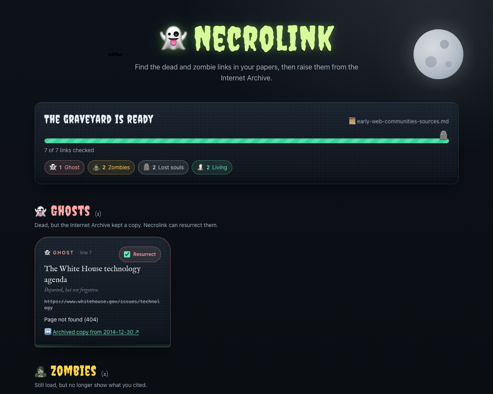

# 👻 Necrolink

**Resurrect dead and zombie links from the digital graveyard**

Necrolink finds broken links in your documents and brings them back to life using the Internet Archive's Wayback Machine. Unlike traditional link checkers that only catch 404s, Necrolink also detects **zombie links** — URLs that still load but no longer show the content you originally cited.



## 🪦 The Problem

Links rot. Research shows that a large portion of web pages from just 10 years ago are already gone. Academic citations, course syllabi, and blog posts are slowly filling up with dead links. Students, researchers, journalists, and Wikipedia editors all struggle with link decay.

## ✨ What Necrolink Does

Drop in a PDF, document, web page, or Markdown file. Necrolink checks every link and sorts them into four categories:

- **👻 Ghosts (dead links)**: Returns 404 or domain is gone. Necrolink replaces these with archived snapshots from the Internet Archive.
- **🪦 Lost souls (unrecoverable)**: Dead, and the Internet Archive has no copy. Necrolink lists these separately so you know to find another source.
- **🧟 Zombies (changed content)**: The link loads, but the content has changed or the domain was hijacked. AI compares the archived and current versions to detect drift.
- **🕯️ Living (healthy links)**: Nothing to fix.

You get back a fixed document with dead links replaced by archive URLs and zombie links flagged with explanations.

## 🔍 How It Works

1. **Extract** (`POST /api/extract`): every link in the PDF, Markdown or HTML, with its anchor text, page or line, and the citation date found next to it ("Retrieved June 15, 2005", "(2023)").
2. **Check** (`POST /api/check`): each link is fetched (HEAD, then GET), results stream to the page as they arrive.
3. **Resurrect**: for dead links, the Wayback Machine capture closest to the citation date. No capture means a 🪦 lost soul, never a fake fix.
4. **Unmask zombies**: links that redirect elsewhere, to a login page or to the homepage get their archived and current text compared. Parked and for-sale domains, spam takeovers and topic changes are caught by text comparison; unclear cases go to the Kiro API when configured.
5. **Export** (`POST /api/export`): the document with ghosts swapped for archive links and zombies and lost souls footnoted. Only the links you tick are changed; everything else stays byte-for-byte identical. PDFs get a resurrection report.

**Safe by design:** private and cloud-metadata addresses are never fetched (SSRF protection, checked on every redirect), uploaded PDFs are parsed with eval disabled, page text sent to the AI is fenced against prompt injection, exported notes are escaped, and requests to the Internet Archive are paced so it never blocks the server.

## 🎯 Current Status

Built for the Kiroween 2026 hackathon. Extraction, checking, zombie detection, export and the graveyard interface all work end to end: 560 tests, including property-based tests with fast-check (see [BUGS_FOUND.md](BUGS_FOUND.md) for what they caught).

Kiro workflow: spec-driven development (`.kiro/specs/`), steering docs (`.kiro/steering/`), agent hooks (`.kiro/hooks/`), Kiro's task plans and reviews (`.agents/tasks/`), and a Wayback Machine MCP server ([`mcp-wayback/`](mcp-wayback/README.md)) that gives Kiro the same archive tools as the app.

## 🚀 Quick Start

```bash
# Install dependencies
npm install

# Run development server
npm run dev

# Run tests
npm test
```

Visit `http://localhost:3000` and click **Try the demo document** to see every kind of link without uploading anything.

### Configuration (optional)

Copy `.env.example` to `.env.local`:

| Variable | Default | Purpose |
|---|---|---|
| `KIRO_API_KEY`, `KIRO_API_BASE_URL`, `KIRO_MODEL` | unset | AI comparison for unclear zombie cases. Without them, text comparison decides. |
| `WAYBACK_MAX_PER_MINUTE`, `WAYBACK_BURST` | 12, 5 | Pace requests to the Internet Archive, which blocks clients that go faster. |

Live tests against the real Wayback Machine: `NETWORK_TESTS=1 npx vitest run tests/network`.

## 📦 Features

### MVP (Must-Have)

- [X] Project setup and structure
- [x] Link extraction from PDF, Markdown, and web pages (`POST /api/extract`)
- [x] Link health checker (ghost/lost soul/zombie/living classification, `POST /api/check`)
- [x] Internet Archive Wayback Machine integration
- [x] AI-powered zombie detection
- [x] Graveyard results interface (live streaming, selective fixing, preview)
- [x] Export fixed documents (`POST /api/export`)

### Stretch Goals

- [ ] Browser extension
- [ ] GitHub Action for CI/CD link checking
- [ ] BibTeX citation support
- [ ] Batch processing for large document sets

## 🛠️ Tech Stack

- **Frontend**: Next.js 14, React, TypeScript
- **Backend**: Node.js API routes
- **AI**: Kiro API (zombie detection)
- **APIs**: Internet Archive Wayback Machine CDX API
- **Deployment**: any Node.js host (Vercel-compatible)
- **Testing**: Vitest with fast-check property-based testing
- **Development**: Kiro IDE (specs, steering, hooks, MCP)

## 📚 Documentation

- [API Reference](docs/API.md) - `POST /api/extract`, `POST /api/check` and `POST /api/export`
- [Bugs Found by Property Tests](BUGS_FOUND.md) - What fast-check caught and how each bug was fixed
- [Wayback MCP Server](mcp-wayback/README.md) - `find_snapshot`, `list_snapshots` and `check_link` for Kiro
- [Demo Video Guide](docs/DEMO.md) - The demo document, what each link shows, and a 3-minute script
- [Product Vision](/.kiro/steering/product-vision.md) - The spooky theme and user experience
- [Technical Conventions](/.kiro/steering/technical-conventions.md) - Code standards and patterns
- [API Guidelines](/.kiro/steering/api-guidelines.md) - Rate limits and caching for external services
- [Specs](/.kiro/specs/) - Feature specifications and implementation plans

## 🤝 Contributing

This is a hackathon project developed with Kiro IDE. The `.kiro/` directory is intentionally committed to demonstrate the development workflow.

## 📄 License

MIT License - see [LICENSE](LICENSE) file for details

## 🏆 Acknowledgments

Built for Kiroween 2026. Special thanks to the Internet Archive for providing the Wayback Machine API that makes this project possible.
